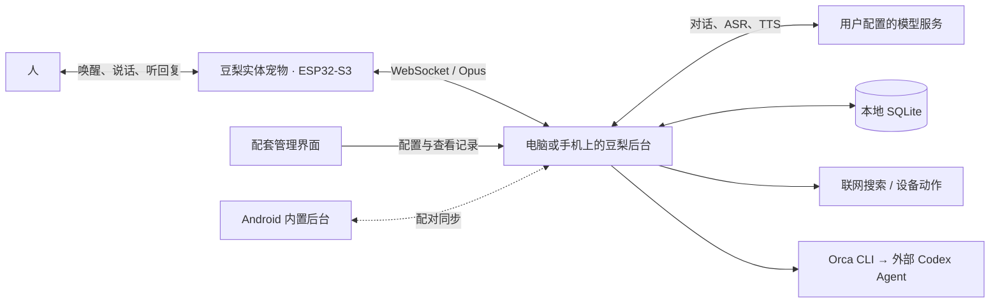

<div align="center">
  
  <h1>豆梨 Douli</h1>
  <p><strong>一只基于 ESP32 的实体电子宠物。喊一声「你好豆梨」，它就开口陪你聊。</strong></p>
  <p>ESP32-S3 硬件原型 · 语音唤醒与打断 · 可更正的长期记忆</p>
  <p><a href="https://124-221-36-36.anyip.dev:8443/douli/">项目官网</a> · <a href="docs/USAGE.md">使用指南</a> · <a href="docs/AI_GUIDE.md">AI 接手指南</a> · <a href="docs/CHANGELOG.md">更新记录</a></p>
</div>

## 这个项目做什么

豆梨是一只放在身边、靠声音和你相处的实体电子宠物。回家时喊它一声，它通过麦克风听你说话，用扬声器回应。你可以在它说到一半时插话，也可以请它记住一条偏好。说完「再见豆梨」，它回到待机，等下一次被唤醒。

目前的硬件原型使用**微雪 ESP32-S3-AUDIO-Board**。板端负责唤醒、收音和播放；电脑或支持的 Android 手机运行配套后台，调用你配置的模型服务，并在本地保存聊天与记忆。需要调整音量、配置模型或查看原话时，再打开管理界面。

它是持续迭代的个人项目，主要展示 **AI 应用工程、实时语音交互、本地数据一致性和软硬件协作**。本仓库包含应用、桌面壳、Android 工程，以及基于小智 ESP32 的固件补丁；不包含自研基础大模型或从零实现的语音芯片固件。

## 可以怎么用

| 场景 | 豆梨的处理方式 |
| --- | --- |
| 一边做事，一边说话 | 识别语音，流式生成回答并分段播放；支持结束对话、静音和打断。实际收音、回声与打断效果取决于设备。 |
| “记住，我不吃香菜。” | 提出记忆建议，经用户确认后参与后续回答；可以查看原话、更正和忘记。 |
| “昨天去了公园。” | 将经历与未来计划分开整理；支持手动补充、主题筛选、修订、移除及追溯原话。 |
| 让宠物换一个后台 | ESP32 可以连接已配对的电脑或手机后台；设置、同步与实机验证范围见 [后台选择](docs/BACKEND_SELECTION.md)。 |
| 把电脑任务交给 Agent | 配置 Orca CLI 后，将任务交给外部 Codex Agent，跟踪状态和继续追问；豆梨负责调度，不把“提交成功”当作任务已经完成。 |

另外包含可选联网搜索、健康资料管理、画面理解和设备动作。它们需要相应配置，不能只靠启动应用就自动获得全部能力。健康功能用于整理资料和辅助检索，不提供诊断保证。

**一次真机排查：为什么豆梨说话会卡？** 后台日志显示音频发送连续，但这不能证明音箱收到得及时。项目在板端记录收包、解码和播放，再用相同的 422 包音频对照：这次公网测试中，板端最长收包间隔达 3.379 秒，解码队列溢出丢了 210 包；局域网对照全部收到并解码，最长间隔为 38 毫秒。由此定位到该次网络路径的停顿，并采用局域网优先、加密公网备用。这是一次指定设备与网络的实测，不是通用延迟承诺。[查看固件实验记录](docs/FIRMWARE.md)

## 从零跑起来

**搭建实体原型**需要带麦克风和扬声器的兼容 ESP32 板、支持小智协议及自定义 OTA 地址的固件、可信 Wi-Fi，以及一台运行后台的电脑或支持的 Android 手机。下面用已验证板型和 Windows 电脑举例。电脑准备 Git、Node.js **22.13 或更新版本**、npm，以及对话、识别、语音合成所用的模型服务。

先启动给宠物提供语音和记忆能力的后台：

```sh
git clone https://github.com/Syfyivan/douli-esp32.git
cd douli-esp32
npm ci
npm run build
npm start
```

1. 保持终端运行，打开 **http://127.0.0.1:8788**。
2. 在「设置 → 模型连接」配置对话、语音识别与合成服务。在「设置 → 功能显示」开启「设备与家居」。
3. 电脑和板子接入同一私人 Wi-Fi。打开设备页的配对窗口，把页面显示的局域网 OTA 服务地址填入兼容固件。核对设备播放或显示的配对码，在电脑端批准设备。此处 OTA 用于发现后台；板型与固件资源见 [固件说明](docs/FIRMWARE.md)。
4. 确认设备已连接。使用已配置「你好豆梨」唤醒资源的板子，喊一声「你好豆梨」，说一句话，听它从扬声器回应；最后说「再见豆梨」，检查它是否回到待机。其他固件的唤醒方式以实际配置为准。

**手边暂时没有板子**时，可以用管理页的文字或「电脑语音」调试后台。板端唤醒、声音播放和回声处理要在实体设备上单独验证。

前台启动用 `Ctrl+C` 停止。Windows 上需要退出终端后继续运行，可改用 `npm run start:background`；仅对该启动器管理的实例使用 `npm run stop`。已有服务时先确认它的归属和数据目录，不要重复启动或随意停止。

| 后续目标 | 命令或文档 |
| --- | --- |
| 调试网页界面 | 后端运行时执行 `npm run dev`，打开 `http://127.0.0.1:8790` |
| 启动桌面开发版 | `npm run desktop`；[桌面说明](docs/DESKTOP.md) |
| 接入 ESP32 | [固件与板型说明](docs/FIRMWARE.md)，从设备页开始配对 |
| Android 独立运行 | [Android 说明](docs/ANDROID.md)，需要另行构建和真机验证 |
| 跨设备数据同步 | [同步说明](docs/SYNC.md)，不会仅因登录同一电脑就自动同步 |

## 它是怎么实现的



**宠物怎样回应你：** ESP32 在本地等待唤醒，唤醒后采集音频 → 后台识别用户发言 → 查找相关记忆、组织上下文 → 模型逐步返回文本 → 合成并播放语音。发生打断时取消旧任务、清理播放队列，并隔离晚到的旧结果。

**一条长期记忆：** 从对话提出候选 → 关联逐字来源 → 用户确认或修订 → 后续按关键词与语义检索。来源发生变化时，相关记录、摘要和向量需要一起失效，避免已经更正的内容再次进入回答。

**一项电脑任务：** 通过 CLI 接入外部 Agent，保留任务与会话身份。遇到超时或提交结果不明确时追踪原任务，避免盲目重发。外部 Agent 的执行能力和最终产物需要独立验收。

| 层次 | 技术与代码入口 |
| --- | --- |
| 界面与音频 | React、Vite、Web Audio / AudioWorklet；[`web/`](web/) |
| 本地服务 | Node.js、Fastify、WebSocket；[`server/app.mjs`](server/app.mjs)、[`server/engine.mjs`](server/engine.mjs) |
| 记忆与生活记录 | SQLite、来源依赖、关键词/向量混合检索；[`server/memory-service.mjs`](server/memory-service.mjs)、[`server/diary.mjs`](server/diary.mjs) |
| 桌面与手机 | Electron；Android 原生服务与内置 Node 运行库；[`desktop/`](desktop/)、[`android/`](android/) |
| 硬件接入 | 小智 ESP32 协议适配与固件补丁；[`firmware/`](firmware/) |

## 数据放在哪里

- 源码运行默认写入 `.data/`；Windows 安装版默认使用 `%APPDATA%/Douli/data`。可用 `DOULI_DATA_DIR` 指定，始终以实际后台为准。
- 普通聊天和记忆是本地 SQLite 数据，**不是全库加密**。密钥设置和健康资料采用各自的加密流程；解密材料同在本机，不能防范已能读取整个数据目录的人。
- 本地保存不等于离线推理：音频、输入和必要上下文会发给配置的模型服务。录音默认不落盘，模型服务可能产生费用。
- 备份应包括数据库与 `local.key`。先正常退出对应后台再复制整个数据目录，或使用 SQLite 一致性备份。不要把 `.data/`、`.runtime/`、密钥和设备配对信息上传到 GitHub。
- 官网只是公开展示站，不连接你的私人后台，也不提供在线录音或真实聊天。

## 已验证到什么程度

2026-11-04 的代码验证为 **304 项自动化测试通过**，前端构建通过，并使用隔离的虚构数据库完成独立后台 HTTP 验收。它证明了这些测试覆盖的软件行为，不代表所有真实使用场景都已通过。

- Windows 桌面、指定 ESP32 板型和 realme 手机有历史实机记录，具体版本与范围分别保存在 [桌面](docs/DESKTOP.md)、[固件](docs/FIRMWARE.md)、[Android](docs/ANDROID.md) 文档中。
- 最新改动没有重新完成全部硬件、安装包、锁屏音频与跨设备验收。
- 模型效果、复杂环境下的收音和长期陪伴体验仍需持续测试；没有宣称生产级 SLA、通用识别率或量化商业收益。

本地软件回归：

```sh
npm test
npm run build
```

`scripts/check-*.mjs` 中部分脚本会调用真实模型或设备，不属于上述离线回归的默认范围。让 AI 运行前，先阅读 [AI 接手指南](docs/AI_GUIDE.md)。

## 继续了解

- **想使用：** [完整使用指南](docs/USAGE.md)、[生活记录](docs/LIFE_RECORDS.md)、[联网搜索](docs/WEB_SEARCH.md)。
- **想看技术细节：** [记忆系统](docs/MEMORY.md)、[连续语音](docs/VOICE_UPGRADE.md)、[提示词](docs/PROMPTS.md)。
- **想让 AI 接手：** [AI_GUIDE.md](docs/AI_GUIDE.md)，包含启动、代码导航、接口示例、测试与交付约定。
- **想维护官网：** [官网运行与部署](docs/WEBSITE.md)。

第三方组件、固件来源与署名见 [THIRD_PARTY.md](docs/THIRD_PARTY.md) 和 [`licenses/`](licenses/)。仓库公开不等于所有内容均采用同一种许可证；复用时请分别核对项目与上游条款。
